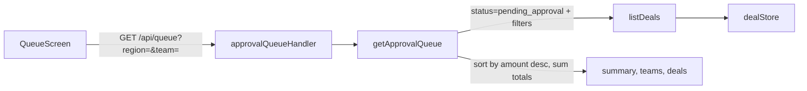
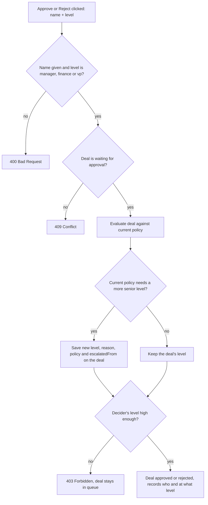

# Spec: Deal Desk fixes - Ticket 01 and Ticket 02

This document covers two tickets:

- **Part A, Ticket 01:** [tickets/01-bug-report.md](../tickets/01-bug-report.md) (Dana Whitfield, Sales Operations).
  Policy changes not taking effect, and finding affected approvals. Backend only.
- **Part B, Ticket 02:** [tickets/02-feature-request.md](../tickets/02-feature-request.md) (Deal Desk managers).
  Filter, sort and summarise the approval queue. Backend and frontend.
- **Part C, follow-on to Ticket 01:** approver levels, and re-checking pending
  deals against the current policy when they are approved or rejected. Backend
  and frontend.
- **Part D, Policy screen input fix:** thresholds could not be typed in, only
  nudged with the arrow buttons. Frontend only.
- **Part E, Test catalogue:** every test added, with what it proves.

Ticket 03 (AI summary) is not touched.

# Part A: Ticket 01

## 1. Problem

Dana lowered the manager approval threshold from 10% to 5%. The Policy screen
shows 5%, but discounts of 6 to 9% were still auto approved. A redeploy made it
look correct for a day, then a later change to the finance limit was also
ignored. She also asked which deals approved this week need a second look.

## 2. Root causes

### Bug 1: the approval engine used a policy cached at first use

`getEffectivePolicy()` in `backend/src/services/policyService.ts` copied the
policy into a module variable the first time it was called and returned that
copy forever. `updatePolicy()` wrote only to the store and never cleared the
copy.

- The Policy screen reads `getPolicy()` (the store), so it showed the new value.
- The approval engine reads `getEffectivePolicy()` (the stale copy), so it kept
  applying the old value.
- A restart cleared the copy, so the first discount checked after the redeploy
  loaded the current policy. That copy was then frozen again, which is why
  Friday's finance limit change was ignored.

Reproduced before the fix: with the manager threshold at 5%, a 7% discount on
d-105 ($22,000) was auto approved. With the finance limit at $50,000, a 14%
discount on d-106 ($90,000) went to a manager instead of finance.

The existing tests did not catch it because none of them changed the policy and
then evaluated a deal, and `resetStore()` did not clear the copy.

### Bug 2: approvals did not record which policy decided them

An `Approval` stored only `requiredLevel`, a free-text `reason`, and who decided.
It did not record the thresholds in force, so there was no reliable way to say
which past approvals were made under the wrong policy. The only option was to
parse reason strings.

## 3. Changes by file

| File | Change |
| --- | --- |
| `backend/src/services/policyService.ts` | Removed the `effective` cache. `getEffectivePolicy()` now reads the store on every call. |
| `backend/src/types.ts` | Added `Evaluation.policy: Policy` and optional `Approval.policyApplied?: Policy`. |
| `backend/src/services/approvalEngine.ts` | `evaluate()` returns the exact policy it used on every branch. |
| `backend/src/services/dealService.ts` | `proposeDiscount()` saves `policyApplied` on both auto approved and pending deals. Added `listAutoApprovalsNeedingReview()` and the `ReviewCandidate` type. |
| `backend/src/controllers/dealController.ts` | Added `needsReviewHandler`. |
| `backend/src/routes.ts` | Added `GET /deals/needs-review`, registered before `/deals/:id`. |
| `README.md` | Added the new endpoint to the API table. |

Approving or rejecting a deal keeps `policyApplied`, because `decide()` already
spreads the existing approval record.

## 4. New endpoint

`GET /api/deals/needs-review`

Returns deals that the agent auto approved (`status: "approved"` and
`approval.decidedBy: "agent"`) which the **current** policy would send to an
approver. It only reads: nothing is reopened or changed.

```json
[
  {
    "deal": { "id": "d-101", "discountPct": 8, "status": "approved", "approval": { "decidedBy": "agent", "...": "..." } },
    "wouldNowRequire": "manager",
    "reason": "Discount 8% exceeds manager threshold (5%)"
  }
]
```

With seed data and the manager threshold at 5%, this returns d-101 (8%). It does
not return d-108 (5%), because "above" means strictly greater than.

Newly created approvals also include the policy snapshot, for example:

```json
"approval": {
  "requiredLevel": "manager",
  "reason": "Discount 7% exceeds manager threshold (5%)",
  "policyApplied": { "managerApprovalAbovePct": 5, "vpApprovalAbovePct": 25, "financeReviewAboveAmount": 100000 }
}
```

## 5. Tests added

All of these failed before the fix (10 new tests). All 32 tests now pass and
`npm run typecheck` is clean.

- `tests/approvalEngine.test.ts`
  - A lowered manager threshold applies to the next discount, even after an
    earlier evaluation (the real-world order that triggered the cache).
  - A lowered finance limit applies to the next discount.
  - `evaluate()` returns the policy it used.
- `tests/policyService.test.ts`
  - `getEffectivePolicy()` matches `getPolicy()` after an update.
- `tests/dealService.test.ts`
  - `policyApplied` is saved on auto approved and pending deals, and kept after
    a human decides.
  - `listAutoApprovalsNeedingReview()` returns nothing under an unchanged policy,
    flags d-101 but not d-108 at 5%, and ignores deals a person approved.

The fix was also checked over HTTP: after `PUT /api/policy` set the threshold to
5%, a 7% proposal went to `pending_approval` (manager), and `needs-review`
returned d-101. `GET /api/deals/d-101` still resolves, so the route order is
correct.

## 6. Assumptions and open questions for Dana

- **Yardstick is the current policy.** A flagged deal is one the policy shown on
  the screen today would not auto approve. If the policy changes again before
  the review, the list changes with it.
- **Only agent auto approvals are flagged.** Deals a manager, VP or finance
  reviewer approved were already seen by a person.
- **No date filter yet.** Dana asked about "this week". Each result includes
  `approval.decidedAt`, so the list can be narrowed by hand. A `since` query
  parameter is a small follow-up.
- **What happens to flagged deals?** This change reports them only. Whether to
  reopen them, notify the owner, or accept them is a business decision.

## 7. Risks

- **Older records have no `policyApplied`.** Seeded deals and anything approved
  before this change lack the snapshot. `needs-review` works for them because
  it re-evaluates against the current policy and does not depend on the snapshot.
- **Behaviour change for reps.** Discounts that were being auto approved will
  now go to the queue as intended, so queue volume may rise after deploy.
- **Policy reads on every evaluation.** The policy is a three-field object in
  memory, so the cost is negligible. If the store moves to a database later,
  any cache must be cleared on update, not kept for the life of the process.
- **Stores stay in memory.** A restart still resets the policy to defaults.
  This existed before this change and is outside this ticket.

## 8. Remediation steps after deploy

1. Deploy, then confirm on the Policy screen that the thresholds are the intended
   ones (5% manager, plus Friday's finance limit).
2. Call `GET /api/deals/needs-review` and share the list with Dana and Finance.
3. Agree with Dana what to do with each flagged deal.

## 9. Follow-ups (not done here)

- ~~Enforce approver level on approve and reject.~~ Done in Part C.
- Add a `since` filter to `needs-review`.
- Record who changed the policy and when, so future questions like this one can
  be answered from an audit log.

# Part B: Ticket 02

## 10. Problem

On a busy day the managers have 40+ deals waiting in one long list. They asked for:

1. Filters by region and by team, so each manager sees their own deals.
2. Biggest deals first, so the most money is handled first.
3. A summary at the top: how many deals are waiting and how much money is waiting.

They also want to tell leadership how much is stuck on approvals.

## 11. Design



- One endpoint returns the deals and the summary together, so the totals always
  match the list on screen and the screen makes a single request.
- Filtering, sorting and totals are done on the server. With 40+ deals this
  keeps the logic in one tested place, and the same endpoint can feed a report
  for leadership later.
- The summary follows the filters. A manager filtered to their team sees their
  team's totals. With no filter it is the whole queue, which is the number for
  leadership.
- `GET /api/deals` also accepts `region` and `team`, so the filters are not tied
  to the queue screen.

## 12. Changes by file

| File | Change |
| --- | --- |
| `backend/src/types.ts` | Added `REGIONS` constant (the `Region` type now derives from it) and a `team` field on `Deal`. |
| `backend/src/seed.ts` | Gave every seed deal a team: Mei and Tom are `Enterprise`, Ravi and Sara are `Commercial`. |
| `backend/src/services/dealService.ts` | `DealFilters` gained `region` and `team`. `listDeals()` applies them and rejects unknown regions with a `ValidationError` (HTTP 400). Added `getApprovalQueue()` with the `QueueSummary` and `ApprovalQueue` types. |
| `backend/src/controllers/dealController.ts` | Added `approvalQueueHandler`. Query values are read only when they are a single non-empty string, so `?region=` means "no filter" and repeated params are ignored. `listDealsHandler` passes `region` and `team` through. |
| `backend/src/routes.ts` | Added `GET /queue`. |
| `frontend/src/api.ts` | Added `team` to `Deal`, the `ApprovalQueue` and `QueueFilters` types, and `api.queue()`. Removed `pendingDeals()`, which the queue screen no longer uses. |
| `frontend/src/App.tsx` | Queue screen: region and team dropdowns, three summary tiles, a Team column. It loads from `/api/queue` and reloads when a filter changes or after approve or reject. |
| `frontend/src/styles.css` | Styles for the dropdowns, the filter row and the summary tiles. |
| `README.md` | Added the new endpoint to the API table. |

## 13. New endpoint

`GET /api/queue?region=NA&team=Enterprise` (both parameters optional)

```json
{
  "summary": { "count": 3, "totalAmount": 366000, "totalNetAmount": 293880 },
  "teams": ["Commercial", "Enterprise"],
  "deals": [ { "id": "d-107", "amount": 210000, "...": "..." }, { "id": "d-102", "...": "..." }, { "id": "d-103", "...": "..." } ]
}
```

- `deals`: only `pending_approval` deals, sorted by `amount` (list price) from
  largest to smallest. Ties are broken by deal id so the order is stable.
- `summary.count`: number of deals in `deals`.
- `summary.totalAmount`: sum of list prices before discount.
- `summary.totalNetAmount`: sum of `amount - amount * discountPct / 100`, what
  the customers would pay if every request is approved. Rounded to cents.
- `teams`: every team with at least one pending deal, ignoring the filter, so
  the team dropdown does not shrink when a filter is applied.
- An unknown region returns HTTP 400 with
  `region must be one of NA, EMEA, APAC, LATAM`.

With seed data and no filter: 5 deals, $531,000 list value, $426,030 after
discounts, in the order d-107, d-102, d-106, d-104, d-103.

## 14. Tests added

10 new tests in `tests/dealService.test.ts`. All 42 backend tests pass and
`npm run typecheck` is clean. The frontend type checks and builds.

- `listDeals` filters by region, and by status plus team.
- `getApprovalQueue`:
  - returns pending deals biggest first;
  - summarises count, list value and value after discount;
  - filters by region, and the summary follows the filter;
  - filters by team, and by region and team together;
  - returns an empty list and a zero summary when nothing matches;
  - lists all teams with pending deals regardless of the filter;
  - drops a deal from the queue and the totals once it is approved;
  - rejects an unknown region.

Checked by hand in the browser: the summary tiles show 5 / $531,000 / $426,030,
the list is in descending amount order, and choosing EMEA shows only Wayne
Freight with the summary at 1 / $90,000 / $77,400.

## 15. Assumptions and open questions for the managers

- **What a "team" is.** Deals had no team field. I assumed a team belongs to
  the rep, and seeded two teams (Enterprise, Commercial). In a real system the
  team would come from the CRM user or territory record, not be typed on the
  deal. Which teams exist, and which manager owns which team, needs confirming.
- **"Biggest" means list price.** Sorting uses the list amount before discount.
  Sorting by net value or by discount dollars is a one-line change if preferred.
- **"Money waiting" is shown two ways.** List value and value after the requested
  discounts. Leadership may want only one of them, or the discount dollars at
  stake (list minus net, $104,970 in the seed data).
- **Amounts are treated as USD.** The `Deal.amount` field is documented as USD,
  so totals across regions are added directly.
- **Default view is everything.** The screen starts on all regions and teams.
  Remembering each manager's last filter is a follow-up.

## 16. Risks

- **New required field.** `Deal.team` is required. Any deal created outside the
  seed must set it, or it will not match a team filter.
- **Team filter is exact match.** `Enterprise` and `enterprise` are different
  teams. Fine while teams come from a fixed list; worth normalising if they are
  ever typed by hand.
- **No pagination.** The whole filtered queue is returned. Fine at 40+ deals,
  but needs paging if the queue grows into the thousands.
- **No access control.** Any user can pick any region or team. The filter is a
  convenience, not a permission boundary.

## 17. Follow-ups (not done here)

- Source teams from a reps or territories table and filter by manager.
- Remember each manager's filter, or default it from who is logged in.
- Add a "waiting since" column and an oldest-first sort, so old deals do not get
  starved by the biggest-first order.
- Break the summary down by approver level (manager, VP, finance).

# Part C: Approver levels and re-check on approval

## 18. Problem in one paragraph

Part A fixed new discount requests, but deals already waiting in the queue were
never looked at again. Each pending deal keeps the approver level it was given
when it was submitted. If the policy is tightened afterwards, the deal still asks
for the old, more junior approver. On top of that, the app did not know who was
a manager and who was a VP: the approver was just a typed name, and anyone could
approve anything. Together, this meant a manager could approve a deal that the
current policy says needs a VP.

## 19. The two rules we added

**Rule 1: who can decide what.** Every approver has a level. Levels are ranked:

| Level | Rank | Can approve **or reject** deals that need |
| --- | --- | --- |
| VP | 3 (most senior) | VP, Finance, Manager |
| Finance | 2 | Finance, Manager |
| Manager | 1 | Manager |

A person can decide a deal at their own level or any level below it. So a VP
can approve or reject a finance deal, but finance cannot approve or reject a VP
deal, and a manager can only decide manager deals.

**Approve and reject have parity.** If you are not senior enough to approve a
deal, you are not senior enough to reject it either. A rejection is a decision
on the deal just like an approval: a junior person turning down a large,
strategic deal that a VP should weigh up is as wrong as them approving it.

**Rule 2: re-check before deciding.** When someone clicks Approve or Reject, the
deal is checked again against the policy as it is right now:

- If the current policy needs a **more senior** level than the deal has, the
  deal is moved up ("escalated") to that level, and the decision goes ahead only
  if the person is senior enough.
- If the current policy needs the **same or a lower** level, nothing changes.
  We never lower a level: a looser policy does not cancel a review that was
  already asked for.

## 20. Step-by-step: what happens when someone clicks Approve or Reject

The same steps run for both buttons.



Note the escalation is **saved even when the decision is refused**. The deal then
shows the correct level in the queue, so the right person picks it up.

## 21. Worked examples (seed data)

| Situation | Who clicks Approve | Result |
| --- | --- | --- |
| Umbrella Logistics, 27%, needs VP | Manager | Refused (403): "Deal d-104 needs vp approval. A manager cannot approve it." |
| Umbrella Logistics, 27%, needs VP | Finance | Refused (403) |
| Umbrella Logistics, 27%, needs VP | VP | Approved |
| Globex, $120,000 at 18%, needs finance | VP | Approved (VP outranks finance) |
| Initech, 12%, needs manager | Finance or VP | Approved |
| Wayne Freight, 14%, submitted as manager. Then the VP threshold drops to 12% | Manager | Refused (403): "The policy changed after this deal was submitted, so it now needs vp approval (Discount 14% exceeds VP threshold (12%)). A manager cannot approve it." Deal now shows **vp**, "policy changed, was manager" |
| Same Wayne Freight deal, after the escalation | VP | Approved; the record keeps `escalatedFrom: "manager"` |
| Wayne Freight ($90,000), then the finance limit drops to $50,000 | Manager | Refused, escalated to finance. Finance or VP can then approve |
| Initech, 12%, then the manager threshold rises to 15% | Manager | Approved. The level stays manager (never lowered) |

Reject follows exactly the same rules:

| Situation | Who clicks Reject | Result |
| --- | --- | --- |
| Umbrella Logistics, 27%, needs VP | Manager | Refused (403): "Deal d-104 needs vp approval. A manager cannot reject it." |
| Umbrella Logistics, 27%, needs VP | Finance | Refused (403) |
| Umbrella Logistics, 27%, needs VP | VP | Rejected |
| Globex, $120,000 at 18%, needs finance | Manager | Refused (403) |
| Globex, $120,000 at 18%, needs finance | Finance or VP | Rejected |
| Wayne Freight, 14%, then the VP threshold drops to 12% | Manager | Refused (403), "…A manager cannot reject it." Deal escalated to **vp** |
| Same Wayne Freight deal, after the escalation | VP | Rejected; the record keeps `escalatedFrom: "manager"` |

## 22. Changes by file

| File | Change |
| --- | --- |
| `backend/src/errors.ts` | New `ForbiddenError`. |
| `backend/src/app.ts` | `ForbiddenError` returns HTTP 403. |
| `backend/src/types.ts` | `Approval` gained `decidedByLevel` (level of the person who decided) and `escalatedFrom` (the level before a policy change raised it). |
| `backend/src/services/approvalEngine.ts` | `DECIDER_LEVELS` (`manager`, `finance`, `vp`), a seniority ranking, `canApprove(approverLevel, requiredLevel)` and `isHigherLevel(a, b)`. |
| `backend/src/services/dealService.ts` | `approve()` and `reject()` now take an `approverLevel` and both go through one `decide()` function. It re-checks against the current policy, saves any escalation, and refuses with `ForbiddenError` if the level is too low. Input checks live in `getPendingDeal()`; the re-check lives in `recheckAgainstCurrentPolicy()`. |
| `backend/src/controllers/dealController.ts` | Reads `approverLevel` from the request body. |
| `frontend/src/api.ts` | `approve()` and `reject()` send `approverLevel`. `Deal.approval` has the two new fields. |
| `frontend/src/App.tsx` | A "Level" picker (Manager, Finance, VP) next to "Deciding as". Approve **and Reject** are greyed out, with a tooltip, on deals above the chosen level. An escalated deal shows "policy changed, was manager" under its level. The queue reloads after a refused decision, so an escalation shows straight away. |
| `frontend/src/styles.css` | Disabled button and escalation label styles. |
| `README.md` | Approve and reject bodies, and the approver ranking. |

## 23. API change

`POST /api/deals/:id/approve` and `POST /api/deals/:id/reject` now need:

```json
{ "approver": "Vic", "approverLevel": "vp", "comment": "optional" }
```

| Response | When |
| --- | --- |
| 200 with the updated deal | Approved or rejected |
| 400 | `approver` missing, or `approverLevel` is not `manager`, `finance` or `vp` |
| 403 | Approve or reject: the decider's level is below what the deal needs (after the re-check) |
| 404 | Deal not found |
| 409 | Deal is not waiting for approval |

An approved deal records the decision like this:

```json
"approval": {
  "requiredLevel": "vp",
  "reason": "Discount 14% exceeds VP threshold (12%)",
  "policyApplied": { "managerApprovalAbovePct": 10, "vpApprovalAbovePct": 12, "financeReviewAboveAmount": 100000 },
  "escalatedFrom": "manager",
  "decidedBy": "Vic",
  "decidedByLevel": "vp",
  "decidedAt": "2026-10-11T22:58:00.000Z"
}
```

**This is a breaking change** for any client that calls approve or reject without
`approverLevel`: it now gets a 400. The only client in this repo, the React
app, is updated.

## 24. Tests added

20 new tests. All 62 backend tests pass, the backend and frontend typecheck, and
the frontend builds.

- `tests/approvalEngine.test.ts`: `canApprove` for all 9 combinations of
  approver level and required level.
- `tests/dealService.test.ts`:
  - an invalid or missing approver level is refused (400);
  - a manager approves manager deals only;
  - finance approves finance and manager deals, not VP deals;
  - a VP approves all three;
  - a refused deal stays pending with no decider recorded;
  - reject uses the same levels as approve: a manager cannot reject finance or
    VP deals, finance cannot reject VP deals, a VP can reject anything;
  - lowering the VP threshold escalates a manager deal to VP, refuses the
    manager, saves the new level, reason, policy and `escalatedFrom`, and then
    lets a VP approve;
  - lowering the finance limit escalates a manager deal to finance;
  - a VP approving a deal that needs escalating succeeds in one step;
  - loosening the policy never lowers a deal's level;
  - reject also escalates after a policy change, refuses the manager, and then
    lets a VP reject.
- Existing approve and reject tests updated to pass a level.

Also checked over HTTP (a manager refused on a VP deal, a VP approving a finance
deal, a missing level, an escalation after lowering the VP threshold) and in the
browser (Approve greyed out on finance and VP deals when "Manager" is picked).

## 25. Assumptions

- **Login sets the level.** In production the level would come from the
  logged-in user's role, and each person sees the queue for their own role. This
  app has no login, so the level is picked on screen and sent with the request.
  The server checks it, but it trusts what it is sent. That is fine for this
  exercise, not for production.
- **Seniority is VP > Finance > Manager.** Agreed with the stakeholder: a VP can
  approve finance deals, finance cannot approve VP deals.
- **Approve and reject have parity.** Agreed with the stakeholder: if you cannot
  approve a deal, you cannot reject it either. (An earlier version let any level
  reject, on the grounds that a rejection never lets a discount through. That
  was changed so a junior approver cannot turn down a deal that belongs to a
  more senior one.)
- **Re-check only when someone decides.** Pending deals are not re-checked when
  the policy is saved. They are re-checked at the moment that matters, when
  someone clicks Approve or Reject. A side effect is that the queue can show an
  outdated level until someone tries to decide.

## 26. Open question: big deals with very large discounts

The approval engine checks rules in this order: finance first, then VP, then
manager. So a deal over $100,000 with a 30% discount is labelled **finance**,
not VP. With the new seniority, **finance can approve it**, even though a 30%
discount on a smaller deal would need a VP.

Example: Hooli Health ($210,000) proposed at 30% would need finance, and a
finance approver could sign it off without any VP.

This was the existing rule order (documented in the README), so it has not been
changed here. If VP should always see discounts above the VP threshold, the fix
is to check the VP rule first in `evaluate()`. That is a business decision for
Dana.

## 27. Risks

- **Trusting the client's level** (see assumptions). Needs real authentication
  before production.
- **Two writes on an escalated approval.** The escalation is saved, then the
  approval. With the in-memory store this is safe; with a database it should be
  one transaction.
- **Frontend copy of the ranking.** The screen has its own copy of the ranking,
  only to grey out buttons. If the two drift, the server still decides; the
  worst case is a button that is enabled but returns 403.

## 28. Follow-ups

- Real login, with the approver's name and level taken from their account.
- Re-check pending deals when the policy is saved, so the queue is always current.
- Decide the open question in section 26.

# Part D: Policy screen input fix

## 29. Problem

On the Policy tab you could not type a new threshold. The only reliable way to
change a value was the arrow buttons, one step at a time. Changing the finance
limit from $100,000 to $50,000 that way is not practical.

What actually happened when you typed (reproduced in the browser):

| You did | Field showed | Why it was wrong |
| --- | --- | --- |
| Deleted the value to retype it | `0` | The field could never be empty |
| Then typed `5` | `05` | A leading zero you had to remove by hand |
| Emptied a field and clicked Save | Saved as `0` | Silent bad data, see below |

## 30. Root cause

In `frontend/src/App.tsx` the form stored each field as a **number** and
converted on every keystroke:

```tsx
onChange={(e) => setPolicy({ ...policy, [key]: Number(e.target.value) })}
```

When the box is empty, the browser reports `""`, and `Number("")` is `0`. React
then put `0` back into the box, so it could never be empty. Anything typed next
landed next to the `0`.

**Why this matters beyond annoyance:** an emptied field was sent to the server
as `0`. The server accepts `0` because it is a valid number. A finance limit of
`$0` would send every discounted deal to finance review, and a manager threshold
of `0%` would send every discount to a manager, with no warning to the user.

## 31. Fix

The form now keeps **exactly what you typed** (as text) while you edit, and only
turns it into numbers when you click Save.

1. Each field holds the raw text, so it can be emptied, retyped, and take
   decimals like `7.5`, with no zero coming back.
2. On **Save**, each field is checked:
   - empty or not a number: an error is shown in red, for example
     "Manager approval above (%) must be a number.", and **nothing is sent**;
   - otherwise the numbers are sent to `PUT /api/policy` as before.
3. The server's existing checks still apply: no negatives, percentages up to
   100, and the VP threshold not below the manager threshold. Its errors now
   show in red; "Policy saved." shows in grey.
4. After a successful save the form reloads from the server's response, so it
   always shows what was actually stored.
5. Small extras on the inputs: `min="0"`, `max="100"` on the two percentage
   fields, `step="any"` so decimals are accepted, and `inputMode="decimal"` for
   a number keypad on touch devices. The arrow buttons still work.
6. Any message clears as soon as you start editing again.

## 32. Changes by file

| File | Change |
| --- | --- |
| `frontend/src/App.tsx` | `PolicyAdmin` keeps a text draft (`PolicyDraft`) instead of numbers, validates on save, and shows errors in red. The three fields are now defined once in `POLICY_FIELDS` (key, label, optional max). |

No backend or API change.

## 33. How it was checked

Frontend typecheck passes. In the running app:

- Emptying "Manager approval above (%)" left it empty (before: it showed `0`).
- Typing `7.5` showed `7.5` (before: leading-zero values like `05`).
- Clicking Save with the field empty showed the red error and sent nothing.
- Typing `10` and saving showed "Policy saved." and `GET /api/policy` returned
  the new value.

There are no frontend unit tests in this repo, so this was checked by hand.
Adding a small component test (for example with Vitest and Testing Library) for
"empty field is not saved as 0" is a sensible follow-up.

## 34. Risks

- **Server still accepts `0`.** `0` is a legitimate value, for example "every
  discount needs a manager", so the server does not reject it. The fix only stops
  the screen from sending `0` by accident. If `0` should never be allowed for the
  finance limit, that is a backend rule to add.
- **Values typed but not saved are lost** when you switch tabs, as before.

# Part E: Test catalogue

Every automated test added in this work, in one place. The names below are the
exact test names, so they can be matched against the test output.

## 35. Totals and how to run

| | Count |
| --- | --- |
| Backend tests before this work | 22 |
| New tests added | 40 |
| Existing tests changed (to pass an approver level) | 4 |
| Backend tests now | 62, all passing |

```bash
cd backend
npm test                            # run all tests
npx vitest run --reporter=verbose   # list every test by name
npm run typecheck
```

The frontend has no automated tests. The manual checks for it are listed in
sections 37 and 38.

## 36. New backend tests

### `tests/policyService.test.ts` (1 new)

| Test | Part | What it proves |
| --- | --- | --- |
| gives the approval engine the same policy the admin screen shows after an update | A | The policy the engine uses is never a stale copy of what the screen shows. The core Ticket 01 bug. |

### `tests/approvalEngine.test.ts` (12 new)

Group **after the policy is changed** (Part A):

| Test | What it proves |
| --- | --- |
| applies a lowered manager threshold to the next discount | Lowering the manager threshold from 10% to 5% makes a 7% discount need a manager, even after an earlier evaluation. Dana's exact symptom. |
| applies a lowered finance limit to the next discount | Lowering the finance limit to $50,000 sends a $90,000 deal to finance. Dana's Friday symptom. |
| returns the policy it used | Each evaluation carries the policy it was decided under, for the audit record. |

Group **canApprove** (Part C), one test per combination, 9 in total:

| Decider | Manager deal | Finance deal | VP deal |
| --- | --- | --- | --- |
| Manager | a manager approving a manager deal -> true | a manager approving a finance deal -> false | a manager approving a vp deal -> false |
| Finance | a finance approving a manager deal -> true | a finance approving a finance deal -> true | a finance approving a vp deal -> false |
| VP | a vp approving a manager deal -> true | a vp approving a finance deal -> true | a vp approving a vp deal -> true |

### `tests/dealService.test.ts` (27 new)

**Audit record of the policy used** (Part A):

| Test | What it proves |
| --- | --- |
| records the policy applied to an auto approved discount | An auto approval stores the thresholds it was decided under. |
| records the policy applied to a discount sent for approval | A deal sent to the queue stores the thresholds too. |
| keeps the recorded policy when an approver decides | Approving does not wipe the stored policy. |

Group **listAutoApprovalsNeedingReview** (Part A, the "which deals need a second look" list):

| Test | What it proves |
| --- | --- |
| returns nothing while the policy is unchanged | No false alarms. |
| flags auto approvals that the current policy would send to an approver | At a 5% threshold, d-101 (8%) is flagged and d-108 (exactly 5%) is not. |
| ignores deals a person approved | Only the system's auto approvals are flagged, not human decisions. |

**Queue filters** (Part B):

| Test | What it proves |
| --- | --- |
| filters the list by region and team | `GET /api/deals` filters by region, and by status plus team. |

Group **getApprovalQueue** (Part B):

| Test | What it proves |
| --- | --- |
| returns pending deals biggest first | Order is d-107, d-102, d-106, d-104, d-103. |
| summarises how many deals and how much money are waiting | 5 deals, $531,000 list, $426,030 after discounts. |
| filters by region and the summary follows the filter | NA gives 3 deals and NA-only totals. |
| filters by team | Enterprise gives its 4 deals. |
| combines region and team filters | EMEA plus Enterprise gives only d-106. |
| returns an empty queue with a zero summary when nothing matches | LATAM has nothing pending; totals are 0, not an error. |
| lists the teams with pending deals, regardless of the filter | The team dropdown does not shrink when filtered. |
| drops deals from the queue once they are decided | An approved deal leaves the list and the totals. |
| rejects an unknown region | `region=MARS` is a 400, not an empty list. |

**Approver level input** (Part C):

| Test | What it proves |
| --- | --- |
| requires a valid approver level | `ceo`, `none` or a missing level are refused with a 400. |

Group **who can approve or reject what** (Part C):

| Test | What it proves |
| --- | --- |
| lets a manager approve manager deals only | Manager is refused on finance and VP deals. |
| lets finance approve finance and manager deals, but not VP deals | Finance is refused on VP deals with a clear message. |
| lets a VP approve VP, finance and manager deals | VP can approve everything, including finance deals. |
| leaves a refused deal waiting in the queue | A refused approval changes nothing: still pending, no decider recorded. |
| applies the same levels to rejecting as to approving | Parity: a manager cannot reject finance or VP deals, finance cannot reject VP deals, a VP can reject anything. |

Group **re-check against the current policy when deciding** (Part C):

| Test | What it proves |
| --- | --- |
| escalates a manager deal to VP after the VP threshold is lowered | Lowering the VP threshold to 12% makes a pending 14% deal need a VP. The manager is refused, the deal shows VP with `escalatedFrom: manager`, then a VP can approve. |
| escalates a manager deal to finance after the finance limit is lowered | Same for the finance limit. |
| approves straight away when the approver already outranks the new level | A VP approving an escalated deal succeeds in one step. |
| never lowers the level when the policy is loosened | A looser policy does not cancel a review already asked for. |
| escalates on reject too, and refuses a decider who is no longer senior enough | The re-check applies to reject as well as approve. |

## 37. Existing tests changed

These four existing tests were updated to pass an approver level. What they
check is unchanged, except that the first now also checks the decider's level.

| Test | Change |
| --- | --- |
| approves a pending deal and records who decided | Passes `manager`; also checks `decidedByLevel`. |
| rejects a pending deal | Passes `vp` (the deal needs a VP). |
| cannot approve a deal that is not waiting for approval | Passes `manager`. |
| requires an approver name | Passes `manager`. |

Three tests added earlier were later changed. The two group names were changed
when reject got the same rules as approve, so they now say "approve or reject"
and "when deciding". The test "lets any level reject" was replaced by "applies
the same levels to rejecting as to approving", and "does not escalate on reject"
was replaced by "escalates on reject too, and refuses a decider who is no longer
senior enough".

## 38. Manual checks (no automated tests)

| Area | Check | Result |
| --- | --- | --- |
| Part A, over HTTP | Lower the manager threshold to 5%, propose 7% | Goes to the queue for a manager, with the policy recorded |
| Part A, over HTTP | `GET /api/deals/needs-review` at 5% | Returns d-101 |
| Part B, browser | Queue with no filter | 5 deals, $531,000, $426,030, biggest first |
| Part B, browser | Filter region EMEA | Only Wayne Freight; summary 1, $90,000, $77,400 |
| Part C, over HTTP | Manager approves or rejects a VP deal | 403 |
| Part C, over HTTP | VP approves a finance deal | Approved, `decidedByLevel: vp` |
| Part C, over HTTP | Lower the VP threshold to 12%, manager approves a 14% deal | 403, deal escalated to VP |
| Part C, browser | Level "Manager" | Approve and Reject greyed out on finance and VP deals |
| Part D, browser | Empty the manager threshold field | Stays empty (before: showed 0) |
| Part D, browser | Type 7.5 | Shows 7.5 (before: leading zeros) |
| Part D, browser | Save with an empty field | Red error, nothing sent |
| Part D, browser | Type a value and save | "Policy saved.", the API returns the new value |
